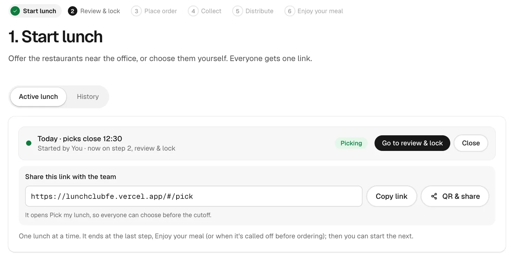
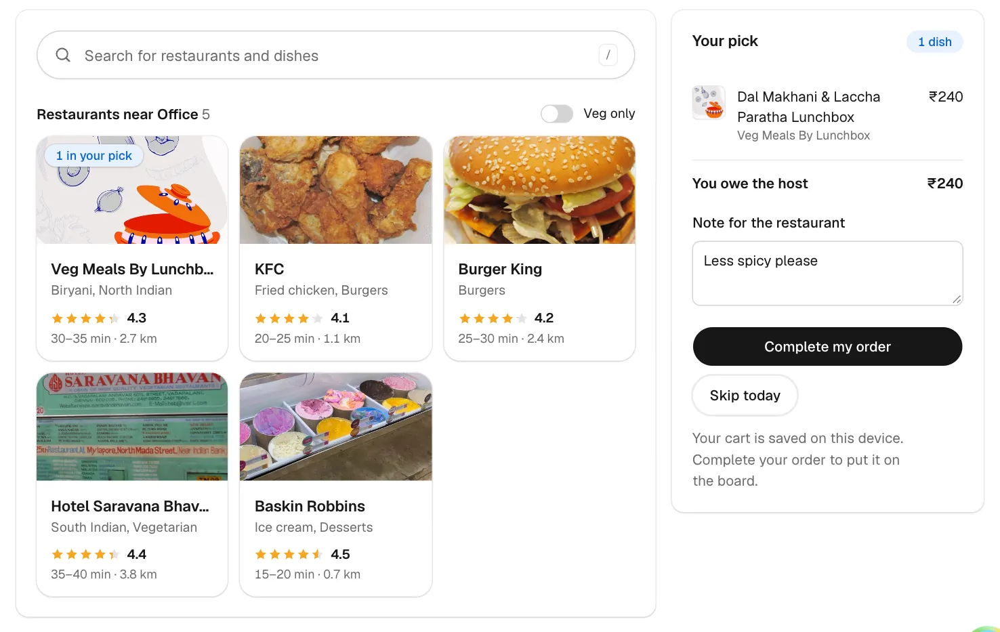
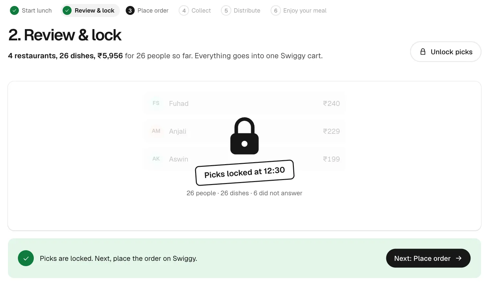
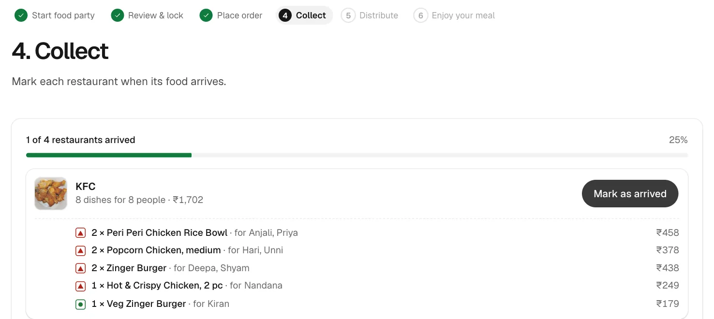

# How to use Lunch Club with an AI assistant

Run lunch by talking to an assistant such as Claude or ChatGPT: start a lunch, share the link, pick dishes, lock the picks and record the order. You sign in once and press Allow. After that the assistant acts as you, with your own permissions (a member's assistant can't lock the picks).

The same steps, examples and tools are on the app's **Connect to an AI assistant** page (`#/connect`).

## 1. Connect (one way: sign in)

1. Open **Connect to an AI assistant** in the app and copy the server address (`https://lunchclub-mcp.vercel.app/mcp` unless your team set `VITE_MCP_URL`).
2. Add it to your assistant:
   - **Claude app or claude.ai:** Settings, Connectors, Add custom connector, name it Lunch Club, paste the address, then Add and Connect.
   - **Claude Code:** run `claude mcp add --transport http lunchclub <address>`, then type `/mcp` and choose Authenticate.
   - **ChatGPT:** Settings, Connectors, Advanced, turn on Developer mode. Choose Create, name it Lunch Club, paste the address as the server URL, set authentication to OAuth and Create. In a new chat add Lunch Club from the + menu and press Connect. Needs a plan or workspace that allows custom connectors; menu names can differ a little.
   - **Other assistants:** any that can add a remote MCP server over HTTP: add it, paste the address, connect.
3. The assistant opens Lunch Club in your browser. Check its name and press **Allow**.

It now shows under **Connected assistants**. Press **Disconnect** any time: it stops working at once and can't sign itself back in.

There are no tokens to make or copy.

## 2. How to use

Plain sentences work. What the assistant says back will vary.

| You say | It uses | In the app |
| --- | --- | --- |
| "Start a lunch at 12:30 for my team near Infopark, and give me the link." | `start_lunch`, `share_lunch` |  |
| "Join this lunch and add the dal makhani lunchbox from Veg Meals By Lunchbox. Less spicy please." | `join_lunch`, `find_restaurants`, `search_dishes`, `pick_dish` |  |
| "How is lunch going? Lock the picks." | `get_lunch`, `lock_lunch` |  |
| "I ordered everything in the Swiggy app. The Veg Meals By Lunchbox food has just arrived." | `mark_order_placed`, `mark_order_arrived` |  |

Anything hard to undo (`confirm_lunch`, `cancel_lunch`) the assistant must ask you about first.

## 3. The tools

**Start and share:** `search_places`, `start_lunch` (host), `share_lunch`, `set_link_open` (host), `join_lunch`.
**Choose food:** `find_restaurants`, `get_menu`, `search_dishes`, `pick_dish`, `remove_pick`, `finish_my_order`, `skip_lunch`.
**Run the lunch (host):** `lock_lunch`, `unlock_lunch`, `confirm_lunch` (asks first), `cancel_lunch` (asks first), `mark_order_placed`, `mark_order_arrived`.
**Look and stay informed:** `whoami`, `list_lunches`, `get_lunch`, `my_notifications`, `mark_notifications_read`.

Two ready-made prompts, in assistants that offer them: `start_team_lunch` and `pick_my_lunch`.

## If something goes wrong

- **"You're not signed in to Lunch Club" or "didn't accept that sign-in":** connect the assistant again (steps above).
- **It says you can't do something:** it can only do what you can in the app, for example only the host locks picks.
- **The Connect page shows "Something went wrong" in development:** restart the dev server with `npm run dev -- --force`, then hard-reload.
